<p align="center">
  
</p>

<p align="center">
  <a href="https://www.anypayx.com"></a>
  <a href="https://github.com/anypay/wallet-bot"></a>
  <a href="https://www.npmjs.com/package/wallet-bot"></a>
  <a href="https://hub.docker.com/r/anypay/wallet-bot"></a>
  <a href="https://github.com/anypay/wallet-bot/blob/master/LICENSE.md"></a>
</p>

<p align="center">
  <a href="https://www.anypayx.com">Website</a> ·
  <a href="https://walletbot.dev">Documentation</a> ·
  <a href="https://api.anypayx.com/api">API</a> ·
  <a href="https://www.anypayx.com/walletbot">WalletBot</a> ·
  <a href="https://github.com/anypay/wallet-bot">GitHub</a>
</p>

---

## What It Is & Purpose

**walletbot.dev** is the official developer documentation portal for **WalletBot** — Anypay's self-custody wallet automation platform that lets developers programmatically send and receive Bitcoin, Ethereum, stablecoins (USDC, USDT, RLUSD, NUSD), and other cryptocurrencies without sacrificing private key control to third parties.

This React-based documentation site provides comprehensive guides, code examples, and API references for integrating WalletBot into your applications. Whether you're building payment automation for a business, developing a crypto application, or need programmatic access to self-custodied wallets, walletbot.dev is your starting point.

Built with Material-UI and React, the site includes interactive examples for Docker deployment, npm library usage, Monero Wallet RPC integration, webhook events, USDC settlements, and the JSON Payment Protocol standard.

## Why Use It

**walletbot.dev makes crypto payment automation accessible and secure:**

- **Complete control:** Your private keys never leave your infrastructure. WalletBot runs on your servers or containers, not on third-party custody platforms.
- **Developer-first:** Clean APIs, npm packages, Docker images, and extensive code samples in multiple languages. Integrate in minutes, not weeks.
- **Multi-chain by default:** One unified API for Bitcoin, Ethereum, Solana, XRP Ledger, Dogecoin, Litecoin, Dash, Stellar, Avalanche, Polygon, Binance Smart Chain, Bitcoin Cash, Bitcoin SV, and more.
- **Stablecoin-native:** First-class support for USDC, USDT, RLUSD, and NUSD across compatible chains, with instant settlement tracking.
- **Production-ready:** Scales from side projects to high-volume merchant processors. Battle-tested by Anypay's payment infrastructure.

**Who it's for:** Backend developers, fintech engineers, Web3 builders, payment platform architects, and businesses that need automated crypto payment workflows with full custody.

**Where it fits:** walletbot.dev is the **documentation gateway** for the [WalletBot library and API](https://github.com/anypay/wallet-bot), which sits between your application logic and blockchain networks. It's part of the Anypay payment ecosystem, working alongside the [Anypay invoice platform](https://github.com/anypay/anypay), the [checkout UI](https://github.com/anypay/web3-checkout-vite), and merchant integrations like [WooCommerce](https://github.com/anypay/anypay-woocommerce).

## How It Works

<p align="center">
  
</p>

The WalletBot architecture follows a **developer → automation → self-custody → settlement** flow:

1. **Developer App**: Your application (Node.js, Python, CLI script, serverless function) needs to send crypto payments. You integrate the WalletBot library or API.

2. **WalletBot API**: The WalletBot service receives payment instructions in JSON Payment Protocol format. It manages wallet connections, balance checks, transaction construction, and signing — all within your infrastructure.

3. **Self-Custody Wallets**: WalletBot holds your private keys locally (environment variables, encrypted keystores, or hardware security modules). It constructs and signs transactions on-chain, broadcasting them directly to blockchain nodes.

4. **Automated Crypto Payments**: Transactions settle on-chain. Recipients receive funds. Your app receives webhook confirmations via the Anypay API, completing the payment loop.

**Key components:**
- **WalletBot Core** (`wallet-bot` npm package): Self-custody wallet manager and transaction builder
- **Docker Container** (`anypay/wallet-bot`): Containerized WalletBot service with API endpoints
- **Anypay API**: Cloud-based payment orchestration, invoice management, and webhook delivery
- **JSON Payment Protocol**: Standardized payment request/response format for interoperability

This site documents all integration paths: direct library usage, Docker deployment, API calls, Monero Wallet RPC, USDC flows, and webhook event handling.

## Quickstart / How to Use It

### Run WalletBot with Docker (fastest start)

```bash
docker run -p 5200:5200 anypay/wallet-bot
```

WalletBot API will be available at `http://localhost:5200`. Configure wallets via environment variables or API calls.

### Install WalletBot as an npm library

```bash
npm install wallet-bot
```

```javascript
import { loadWallet } from 'wallet-bot';

async function sendPayment() {
  const wallet = await loadWallet([{
    asset: 'BTC',
    address: 'your-bitcoin-address',
    privatekey: 'your-private-key-or-mnemonic'
  }]);

  const [balance] = await wallet.balances();
  console.log('Balance:', balance);

  const payment = await wallet.buildPayment({
    chain: 'BTC',
    currency: 'BTC',
    instructions: [{
      outputs: [{
        address: 'recipient-address',
        amount: 50000  // satoshis
      }]
    }]
  });

  console.log('Payment sent:', payment.tx_hash);
}

sendPayment();
```

### Develop and deploy this documentation site

The walletbot.dev site itself is a React application. To run it locally:

```bash
cd website
npm install
npm start
```

The site will open at `http://localhost:3000`. Docs pages are in `src/views/docs/`.

To build for production:

```bash
npm run build
```

The optimized bundle will be in `website/build/`.

**Deployment:**

```bash
npm run deploy
```

This copies the build to the production server at `walletbot.dev` (requires SSH credentials).

### Explore the full documentation

Visit [walletbot.dev](https://walletbot.dev) or navigate locally to:
- `/docs-introduction` — WalletBot overview and architecture
- `/docs-quick-start` — Installation and first payment
- `/docs-monero` — Monero Wallet RPC integration
- `/docs-webhooks` — Payment webhook events
- `/docs-usdc` — USDC and stablecoin setup

## Next Moves for Growth

**High-leverage improvements grounded in the current state of this repository:**

1. **Update package dependencies**: The site uses React Scripts 5.0.1 and Material-UI v5.2.4. Upgrade to latest stable versions to fix known security vulnerabilities (check `npm audit` and Dependabot PRs).

2. **Replace generic template branding**: Several files still reference "Webbee" and "Maccarian Agency" (original Material-UI template authors). Search for `webbee`, `maccarian`, and `maccarianagency.com` across `website/src/` and replace with Anypay branding and walletbot.dev URLs. Update favicon and OG image in `website/public/index.html`.

3. **Expand docs coverage**: Current docs focus on Monero, webhooks, and USDC. Add missing guides for:
   - Bitcoin setup (the most common use case)
   - Ethereum and EVM chains (Polygon, Avalanche, BSC)
   - Hardware wallet integration (Ledger, Trezor)
   - Environment variable configuration
   - Production deployment (Kubernetes, AWS ECS, systemd)
   - API authentication and rate limits

4. **Add interactive code examples**: The existing SyntaxHighlighter blocks are static. Integrate a live code sandbox (CodeSandbox, StackBlitz) so developers can test WalletBot snippets in-browser without local setup.

5. **SEO and discoverability**: The site's `<meta>` tags still use generic template descriptions. Update `website/public/index.html` and add dynamic `<title>` and `<meta name="description">` per route. Submit sitemap to search engines. Add structured data (JSON-LD) for developer documentation.

6. **Enable dark/light mode toggle**: Material-UI theming is configured but the mode switcher is not implemented. Add a persistent theme toggle in the header so developers can choose their preferred documentation reading experience.

7. **Automate deployment with CI/CD**: The current `deploy` script uses SCP to a production server. Replace with GitHub Actions that build on push to `master`, run tests, and deploy via Vercel, Netlify, or Cloudflare Pages for zero-downtime, preview deployments, and automatic HTTPS.

## Anypay Ecosystem & License

**walletbot.dev** is part of [Anypay](https://www.anypayx.com) — Bitcoin & Stablecoin payments for business. Merchants and developers use Anypay to accept BTC, ETH, and stablecoins such as USDC, USDT, RLUSD, and NUSD through invoices, APIs, SDKs, webhooks, WooCommerce, and mobile POS.

| Project | Role |
| --- | --- |
| [walletbot](https://github.com/anypay/wallet-bot) | Self-custody wallet automation library & API (the core WalletBot service) |
| [anypay](https://github.com/anypay/anypay) | Invoice & payments platform / API (`@anypay/server`) |
| [anypay-sdk](https://github.com/anypay/anypay-sdk) | TypeScript SDK for browser & Node.js (`@anypay/client`) |
| [web3-checkout-vite](https://github.com/anypay/web3-checkout-vite) | Current checkout UI (`checkout.anypayx.com`) |
| [anypayx.com](https://github.com/anypay/anypayx.com) | Marketing site, merchant dashboard, and developer docs |
| [merchant-app](https://github.com/anypay/merchant-app) | iOS & Android point-of-sale |
| [anypay-woocommerce](https://github.com/anypay/anypay-woocommerce) | Official WooCommerce plugin |

**License**

This documentation site is licensed under the [MIT License](LICENSE.md). The WalletBot library itself is also MIT-licensed. See individual repository LICENSE files for details.

**Contributing**

Contributions are welcome! To improve the docs:
1. Fork this repository
2. Create a feature branch (`git checkout -b docs/improve-monero-guide`)
3. Make your changes in `website/src/views/docs/`
4. Test locally (`npm start`)
5. Submit a pull request

For WalletBot core features, open issues or PRs at [github.com/anypay/wallet-bot](https://github.com/anypay/wallet-bot).

---

<p align="center">
  <a href="https://www.anypayx.com"></a><br/>
  <sub>Bitcoin & Stablecoin Payments For Business · <a href="https://www.anypayx.com">anypayx.com</a> · <a href="https://x.com/xanypay">@xanypay</a></sub>
</p>
